<div align="center">

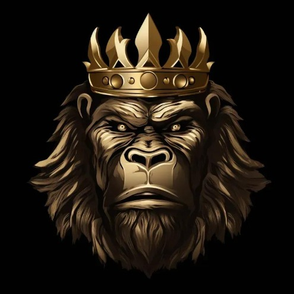

# 🐒 MAYMUN KRALLIĞI

**Lanetli topraklarda geçen, beş bölümlük 3D aksiyon-macera oyunu.**
Bir kahraman seç, canavar sürülerini yar, beş bölüm sonu kralını devir ve kendi köyünü kur.

Telefonda (dikey ve yatay) ve bilgisayarda doğrudan tarayıcıda oynanır, kurulum gerektirmez.

▶️ **[OYNA → cagdasozsahin.github.io/Maymun-Kralligi](https://cagdasozsahin.github.io/Maymun-Kralligi/)**

</div>

---

## 🎮 Nasıl oynanır

| Telefon | Bilgisayar | Ne yapar |
|---|---|---|
| Sol alttaki joystick | `W A S D` | Hareket |
| **SALDIR** | Sol tık / `J` | Saldırı (art arda basınca 3'lü kombo) |
| **YUVARLAN** | Sağ tık / `K` | Saldırıdan kaçmak için yuvarlanma |
| **ZIPLA** | `Space` | Zıplama |
| Ekranı sürükle | Fareyle sürükle | Kamerayı çevir |
| Çanta simgesi | `I` | Envanter (kristaller, meyveler, sandıklar) |
| Hızlı kristal düğmeleri | `1` `2` `3` | Can / Kalkan / Güç kristali kullan |
| Duraklat düğmesi | `Esc` | Duraklat, ses aç/kapat |

**İpuçları**
- **Enerji meyvesi** canını doldurur; canın zaten doluysa çantaya girer, sonra kullanırsın.
- **Kristaller:** Can (iyileştirir), Kalkan (bir süre hasar almazsın), Güç (vuruşların güçlenir).
- **SHADOW** ile SALDIR'a basınca yay, yüzünün dönük olduğu yöndeki en yakın canavara kendiliğinden nişan alır.
- Her bölüm sonu kralı yenilince bir **sandık** düşer; bölümleri tekrar oynayarak yeniden kazanabilirsin.

---

## 🦍 Kahramanlar

| | Kahraman | Silah | Tarz |
|:---:|---|---|---|
| 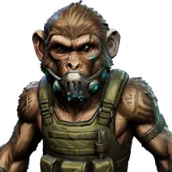 | **AZRAK** | Kılıç | Dengeli, hızlı kombolar |
| 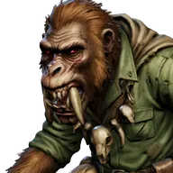 | **RAZOR** | Çift hançer | Çok hızlı, yakın dövüşçü |
| 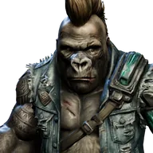 | **THORGAR** | İki elli balta | Yavaş ama çok güçlü |
| 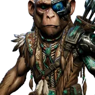 | **SHADOW** | Yay | Uzaktan, otomatik nişanlı oklar |
| 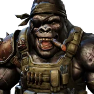 | **GRIMKAR** | Zincirli topuz | Geniş alana vuruş |

---

## 👹 Canavarlar

<table>
<tr>
<td align="center">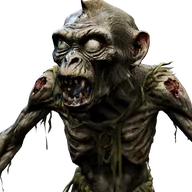<br><b>KANCITRAN</b></td>
<td align="center">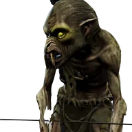<br><b>SHADOW ARROW</b></td>
<td align="center">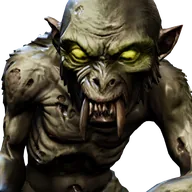<br><b>HEAD CRUSHER</b></td>
</tr>
<tr>
<td align="center">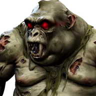<br><b>GOLYAT</b></td>
<td align="center">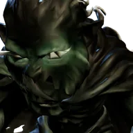<br><b>BLACK MAGIC</b></td>
<td align="center">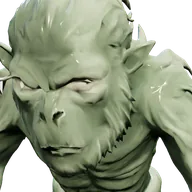<br><b>WHITE DEVIL</b></td>
</tr>
</table>

---

## 👑 Bölümler ve krallar

| | Bölüm | Bölüm sonu kralı |
|:---:|---|---|
| 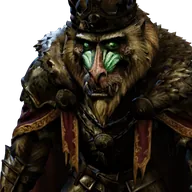 | **I · Lanetli Orman** | **KING GORGOR** |
| 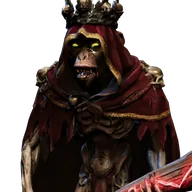 | **II · Sisli Bataklık** | **KING ZARKOV** |
| 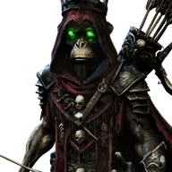 | **III · Yanardağ Geçidi** | **KING SLYVAN** |
| 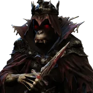 | **IV · Kan Katedrali** | **VAMPIRE KING** |
| 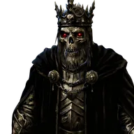 | **V · Maymun Kralın Tahtı** | **KING MALAKOR** (final) |

Her bölümde ormanı, bataklığı ya da geçidi aşıp kale kapısındaki muhafızı yener, ardından arenada kralla karşılaşırsın. Her kral seni alaycı bir kahkahayla karşılar ve kendine özgü saldırıları vardır.

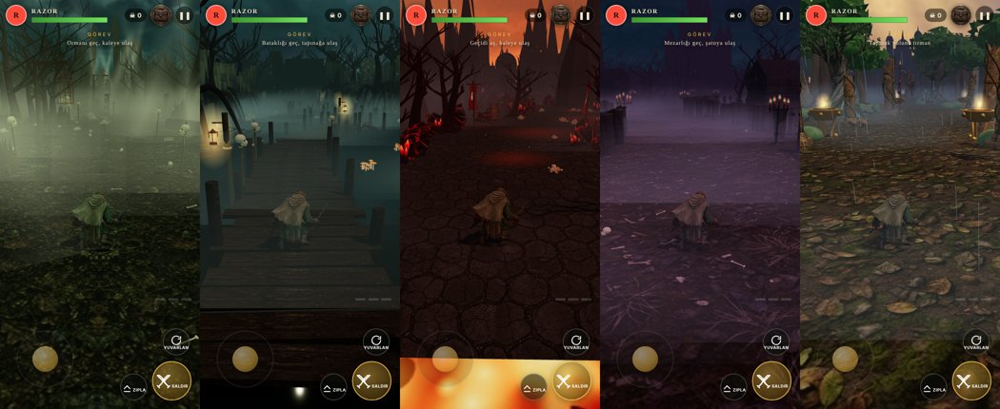

---

## 🏰 Maymunların Şafağı (köy modu)

Ana menüdeki **MAYMUNLARIN ŞAFAĞI** düğmesiyle açılan, kendi kaydı olan ayrı bir mod.

- **Kaynak topla:** Ormanda ağaç kes (🪵 odun), Kaya Ocağı'nda kaya kır (🪨 taş), madende kaz (⛏ demir), Siyah Mermer Ocağı'nda mermer çıkar (◆).
- **Kaleni yükselt:** Ahşap Kale → **Taş Kale** → **Demir Kale** → Siyah Mermer Kale. Yükseltince kale, surlar, kuleler ve kapı birlikte değişir.
- **Canlı köy:** Meydanda dolaşan köylüler, demirci, atölye, çiftlik, kuyu, mangallar ve sur meşaleleri.
- **Yakında:** gece-gündüz döngüsü, gece kuşatmaları ve sandıklarla açılan savaşçılar **SAMU** ve **ROCKMAN**.

<p>
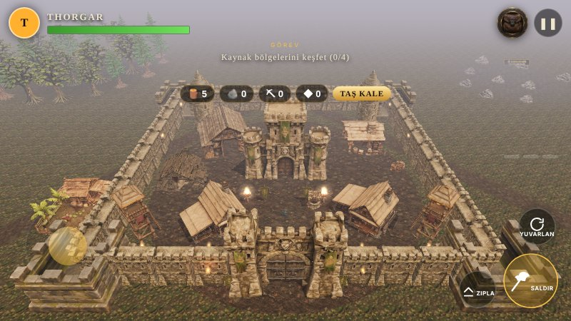
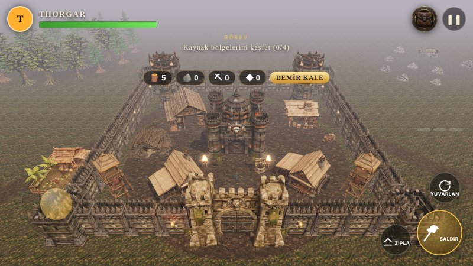
</p>

---

## 🛠️ Teknik

- **Motor:** [Three.js](https://threejs.org) (WebGL), tek dosyalık HTML sayfaları, sunucu gerektirmez.
- **Modeller:** GLB (meshopt sıkıştırmalı), dokular WebP/JPG.
- **Ses:** Web Audio API; bölüm müzikleri, ortam sesleri, ölüm ve kahkaha efektleri.
- **Kayıt:** Tarayıcı hafızasında (`localStorage`): bölüm ilerlemesi, envanter, profil, köy.
- **Performans:** Telefon için en yakın ışıkları yakan ışık sistemi, örneklemeli (instanced) çizim.

### Dosya yapısı

```
index.html          Ana menü (profil, kahraman ve bölüm seçimi)
bolum1-5.html       Beş bölüm
koy.html            Maymunların Şafağı (köy modu)
models/             3D modeller (.glb)
tex*/               Bölüm dokuları
ses/                Müzik ve ses efektleri
avatars/  ui/       Profil resimleri ve arayüz görselleri
```

### Kendi bilgisayarında çalıştırma

Modeller `fetch` ile yüklendiği için dosyaya çift tıklamak yerine basit bir sunucu kullan:

```bash
python3 -m http.server 8000
# tarayıcıda: http://localhost:8000
```

---

<div align="center">

Geliştiren: **Çağdaş Özşahin** · [@Cagdasozsahin](https://github.com/Cagdasozsahin)

</div>
